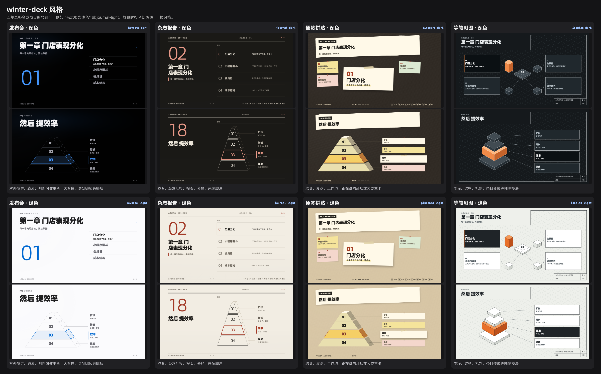

# winter-deck

[中文说明、安装与用法](README.md)

## 4 styles, each in dark and light

| Style | Composition | Best for | Preset IDs |
|---|---|---|---|
| Keynote | A judgment-led headline, generous whitespace, focus on the item being discussed | Product launches, technology, public talks, pitches | `keynote-dark`, `keynote-light` |
| Journal | Mastheads, columns, source footnotes | Consulting, research, business reviews | `journal-dark`, `journal-light` |
| Pinboard | The current item expands into the main card | Training, retrospectives, workshops, brainstorming | `pinboard-dark`, `pinboard-light` |
| Isoplan | Items become modules with visible structural relationships | Processes, architecture, organizational mechanisms, spatial topics | `isoplan-dark`, `isoplan-light` |

When no more specific setting is given, recommend Keynote for external talks, Journal for internal reports, and Pinboard for training.

Press **P** to switch dark/light and **T** to cycle styles during a presentation.

