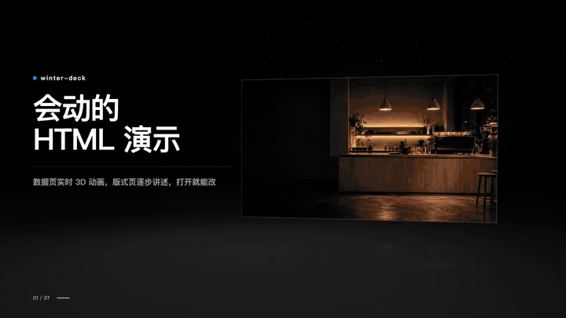
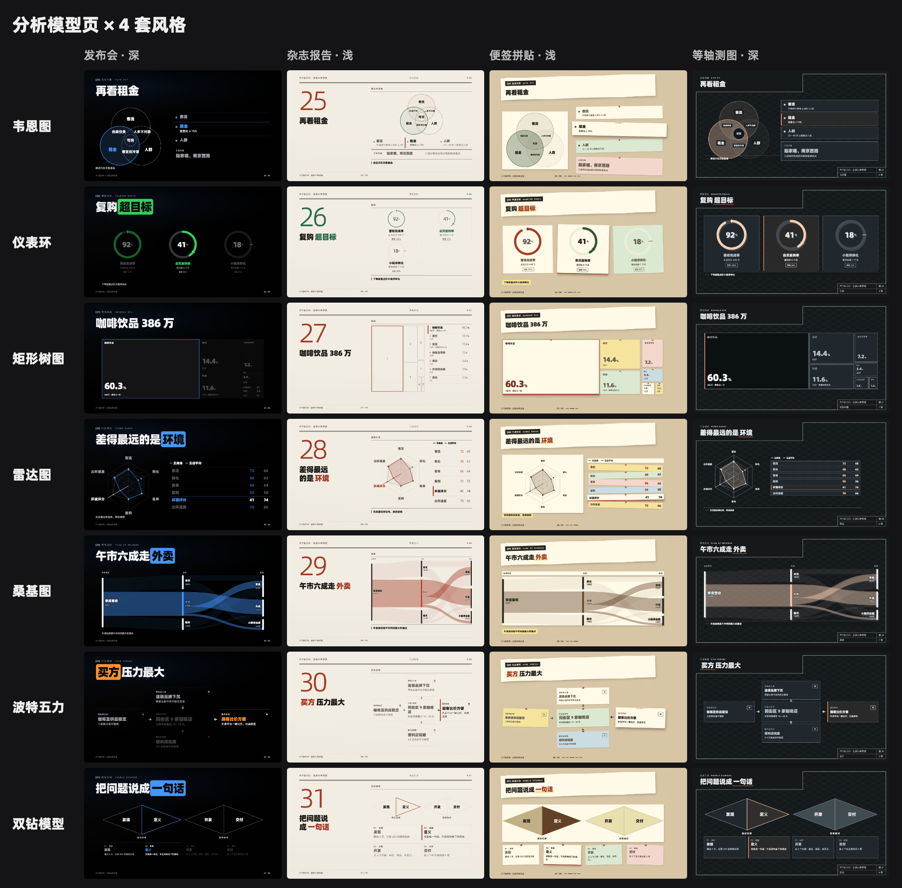
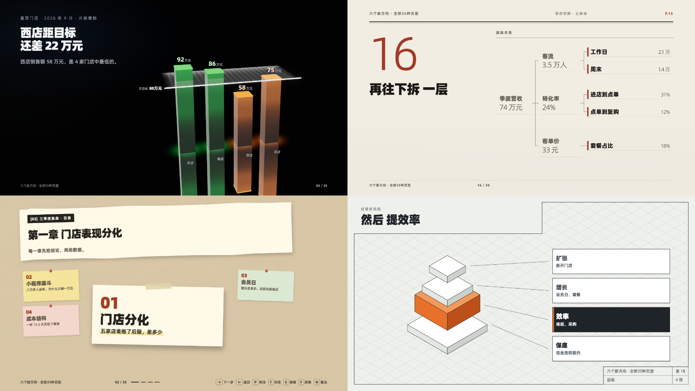
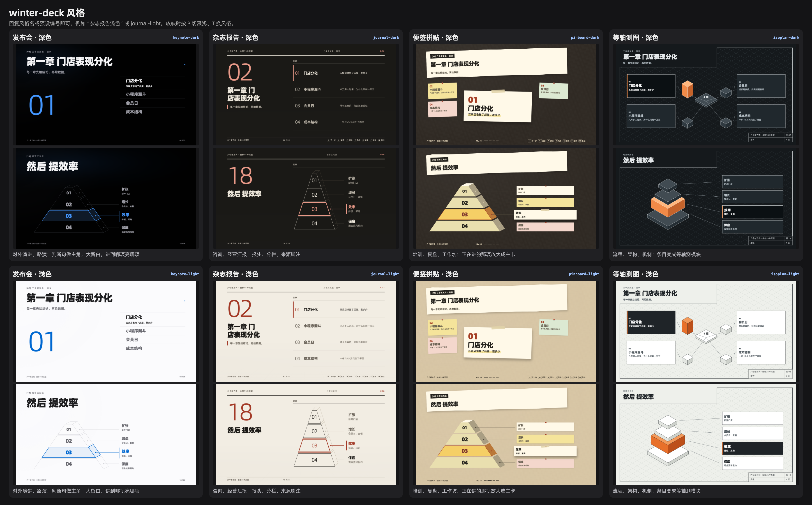

# winter-deck · 会动的 HTML 演示

把材料交给你的 AI Agent，得到一份**在浏览器里实时播放动画、打开就能直接改**的演示文件。



*上图是浏览器里实时播放的录屏，不是视频剪辑：每按一下方向键，柱子、仪表环、流向、曲线跟着动起来。*

**收到文件的人什么都不用装**：一个 HTML 文件，双击用 Chrome / Edge 打开就能放，离线也行。

## 它和普通 PPT、普通网页 PPT 不一样的地方

- **动画是实时运行的，不是录好的视频。** 数据改了，柱子、漏斗、曲线、仪表环跟着重新长出来。
- **整份演示是一个连续的空间。** 数据页是 3D 场景，翻页是镜头飞过去；文字和图表页是铺满版面的编辑式排版，翻进来时内容依次出场。
- **每按一下讲一个点。** 标题和画面一起推进，当前讲到的那一块整块亮起。
- **打开就能改。** 按 E 进入编辑台：左边页面目录，右边控制台——改字、换图、改图表数据，拖滑杆改项目数量、换重点、换同类版式、换本页强调色。⌘S / Ctrl+S 保存回同一个文件。
- **一个 HTML 文件，离线可开。** 图片和程序都在文件里，发给别人双击就能放。

## 30 多种页型

**3D 数据页**（数据会动）：比较柱、漏斗、趋势、占比、大数字。

**版式页**（铺满版面，排法随风格变化，讲到哪项哪项亮起）：要点、关键数字、表格、四象限（SWOT / PEST / 波士顿矩阵 / 优先级）、章节、金句、客户证言、流程、时间线、路线图、对比、树状拆解、金字塔、循环、功能卖点、风险、团队、行动项。

**分析模型页**：韦恩图、仪表环、矩形树图、雷达图、桑基图、波特五力、双钻模型。

**图文页**：封面、证据截图（推近到要看的区域）、图文阅读、图组、全幅照片。手上还没图时可以先留图位，之后在编辑台里换。





## 4 套风格，每套深色和浅色两版

| 风格 | 构图 | 适合 |
|---|---|---|
| 发布会 | 判断句做主角，大留白，讲到哪项亮哪项 | 产品发布、科技、对外演讲、路演 |
| 杂志报告 | 报头、分栏、来源脚注 | 咨询、研究、经营汇报 |
| 便签拼贴 | 正在讲的那项放大成主卡 | 培训、复盘、工作坊、头脑风暴 |
| 等轴测图 | 条目变成模块，结构关系可见 | 流程、架构、组织机制、空间类 |

没有更明确场合时，对外推荐发布会，对内汇报推荐杂志报告，培训推荐便签拼贴。

放映时按 **P** 切深浅，按 **T** 换风格；保存时记住当前风格。



## 安装

也可以[直接下载 ZIP](https://github.com/qwbwj3/winter-deck-skill/archive/refs/heads/main.zip)，解压后在含有 `install.mjs` 的目录运行 `node install.mjs`。

需要 [Node.js](https://nodejs.org) 18 以上；放映和截图检查用 Chrome 或 Edge。

**方法一：让你的 Agent 装**（Claude Code、Codex 等都可以）

把这句话发给它：

```text
帮我安装 skill：git clone https://github.com/qwbwj3/winter-deck-skill，然后在仓库目录运行 node install.mjs
```

**方法二：Claude Code 插件**

```text
/plugin marketplace add qwbwj3/winter-deck-skill
/plugin install winter-deck@winter-deck
```

**方法三：自己装**

```bash
git clone https://github.com/qwbwj3/winter-deck-skill
cd winter-deck-skill
node install.mjs
```

`install.mjs` 会把 Skill 复制到 `~/.claude/skills/` 和 `~/.codex/skills/`（哪个存在装哪个）。只装一个：加 `--claude` 或 `--codex`；装到别处：`--dir <路径>`；卸载：`--uninstall`。

## 使用

对你的 Agent 说：

```text
用 winter-deck 帮我把这份材料做成演示
```

把材料（文档、数据、截图）一起给它。它会先列一张页面清单给你确认（每页要讲的一句结论、用哪种页型），确认后做出 `out/<名字>.html`。

放映时：

| 按键 | 作用 |
|---|---|
| → / ← | 下一步 / 上一步（翻页笔也可以） |
| P | 深色 / 明亮 |
| T | 换风格 |
| E | 进入编辑：点文字直接改，右侧面板改全部文字、换图、改图表数据 |
| ⌘S / Ctrl+S | 保存回同一个文件 |
| Q | 切换画质（低配电脑会自动降档） |

在浏览器里改过、保存过的文件，之后还可以交回给 Agent 接着改，它会先把你的修改提取出来，不会覆盖。

## 常见问题

**电脑比较旧，会不会卡？** 打开后会先测一下帧率，跑不动会自动降低 3D 画质，文字始终保持清晰。也可以按 Q 手动切。

**能导出成 .pptx 吗？** 不能。3D 动画放不进 PowerPoint，导出就只剩静态图片。需要发给只用 PowerPoint 的人时，直接发 HTML 文件，双击就能放。

**中文字体？** 用阿里巴巴普惠体 3.0。打包的电脑装有这套字体时，只把这份演示用到的字裁出来嵌进 HTML（约多 360KB），发给别人打开字形一致；没装就用系统黑体（苹方 / 微软雅黑），打包时会提示。本仓库不含任何字体文件，普惠体请从阿里巴巴官方渠道免费下载安装。

**Agent 会不会乱写代码？** 不会改动画代码。它只负责拆页、填数据、配图、跑检查脚本，画面由 Skill 里的运行时保证。

**遇到问题？** 到 [Issues](https://github.com/qwbwj3/winter-deck-skill/issues) 提交，附上系统、浏览器、Agent 名称和截图。

## 示例素材

随包的经营数字、案例和 MES 界面仅用于演示。咖啡馆、工厂及设备图片为 AI 生成的示意图。

## 作者

王温特。用 AI 做真实的工作流，做完把方法和工具分享出来。

## 授权

[MIT](LICENSE)。可以免费用、改、商用，保留版权声明即可。

第三方组件声明：[three.js](skills/winter-deck/scripts/vendor/THREE-LICENSE.txt)、[harfbuzzjs](skills/winter-deck/scripts/vendor/HARFBUZZ-LICENSE.txt) 和 [HarfBuzz](skills/winter-deck/scripts/vendor/HARFBUZZ-CORE-COPYING.txt)。
